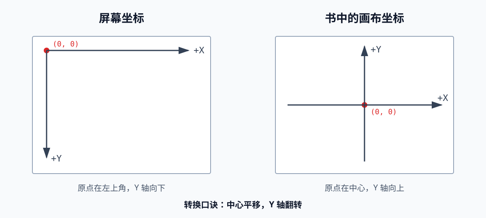

# 第 1 章：基础入门概念

> 本章目标：建立整本书共用的最小语言。暂时不研究“怎样渲染”，只明确渲染的输入、输出和基本数据。

## 30 秒掌握本章

**渲染，就是根据三维场景，计算二维画布上每个像素的颜色。**


只记住五个字：

> **景、坐、色、布、点**

| 关键词 | 含义 |
|---|---|
| 景 | 三维场景是输入 |
| 坐 | 坐标确定位置 |
| 色 | RGB 表示像素颜色 |
| 布 | 二维画布是输出 |
| 点 | `PutPixel` 完成最终写入 |

---

## 1. 画布：渲染的终点

画布（Canvas）是一个二维像素数组。每个像素保存一种颜色。

本书后续的所有算法，最终都要完成同一件事：

```cpp
PutPixel(x, y, color);
```

它回答的问题是：

> 画布上 `(x, y)` 位置的像素应该是什么颜色？

画布只关心像素，不关心图像最终显示在屏幕、保存到文件还是打印到纸上。这种“只规定结果，不限制载体”的思路，就是画布抽象的价值。

---

## 2. 坐标：如何定位像素

屏幕坐标和书中使用的画布坐标不同。



### 屏幕坐标

- 原点在左上角
- `x` 向右增大
- `y` 向下增大

这种方式符合显存和图像数据从上到下排列的习惯。

### 画布坐标

- 原点在画布中心
- `x` 向右增大
- `y` 向上增大

这种方式更符合数学和三维图形的直觉。

### 坐标转换

假设画布宽、高分别为 `Cw`、`Ch`：

```text
screenX = Cw / 2 + x
screenY = Ch / 2 - y
```

记忆：

> **中心要平移，Y 轴要翻转。**

坐标超出画布范围时，`PutPixel` 应直接忽略，不能访问无效内存。

---

## 3. 颜色：RGB 三个通道

屏幕从黑色开始，通过增加不同强度的红、绿、蓝光产生颜色，因此使用 RGB 加色模型：

```text
Color = (R, G, B)
```

常见颜色：

| 颜色 | RGB |
|---|---|
| 黑 | `(0, 0, 0)` |
| 白 | `(255, 255, 255)` |
| 红 | `(255, 0, 0)` |
| 绿 | `(0, 255, 0)` |
| 蓝 | `(0, 0, 255)` |
| 黄 | `(255, 255, 0)` |

### RGB 与 CMYK

| 使用场景 | 模型 | 原理 | 混合趋势 |
|---|---|---|---|
| 屏幕 | RGB | 主动增加光 | 越加越亮，最终为白 |
| 印刷 | CMYK | 从白光中吸收部分波长 | 越混越暗，接近黑 |

记忆：

> **屏幕加光用 RGB，印刷减光用 CMYK。**

本书面向屏幕渲染，后续只使用 RGB。

---

## 4. 颜色深度：能表示多少颜色

常见的 `R8G8B8` 格式为每个颜色通道分配 8 位：

```text
3 个通道 x 8 位 = 24 位
2^24 = 16,777,216 种颜色
```

每个通道的取值范围为 `0～255`。

位数越少，可表示的颜色越少，平滑渐变中越容易出现明显的色带。书中还提到 `R5G6B5` 格式：绿色多分配一位，是因为人眼通常对绿色变化更敏感。

---

## 5. 颜色运算：把颜色看成向量

学习本书时，可以把 RGB 暂时看成一个三维向量。

### 调整强度

每个通道同时乘以常量 `k`：

```text
k(R, G, B) = (kR, kG, kB)
```

例如：

```text
2 x (16, 0, 64) = (32, 0, 128)
```

### 颜色相加

对应通道分别相加：

```text
(R1, G1, B1) + (R2, G2, B2)
= (R1+R2, G1+G2, B1+B2)
```

例如：

```text
(255, 0, 0) + (0, 255, 0) = (255, 255, 0)
红色          + 绿色          = 黄色
```

### 限幅 Clamp

运算结果必须限制在有效范围内：

```text
value < 0   -> 0
value > 255 -> 255
```

```cpp
value = std::clamp(value, 0, 255);
```

可以直观理解为：过低变成纯黑，过高产生过曝。

> 本章采用的是便于学习渲染原理的简化颜色模型，暂不讨论 Gamma、线性颜色空间和 HDR。

---

## 6. 场景：渲染的输入

场景（Scene）是需要渲染的三维对象集合，例如：

- 物体及其位置、形状、材质
- 光源
- 相机

场景坐标与画布坐标不能混用：

| 坐标系 | 维度 | 常用单位 | 作用 |
|---|---:|---|---|
| 画布坐标 | 2D | 像素 | 确定图像画在哪里 |
| 场景坐标 | 3D | 自定义空间单位 | 描述物体在哪里 |

书中约定 `Y` 轴向上，可以把 `XZ` 平面理解为地面。空间单位可以表示米、厘米或任意比例，关键是整个场景保持一致。

---

## 7. 在 Qt/C++ 中如何对应

第一章还不需要 OpenGL。按照书中的思路，可以先让 C++ 直接操作一张 `QImage`，再交给 QML 显示。

```text
QML：窗口、参数和图像显示
                 ↑
C++：渲染算法 -> QImage
```

最直观的 `PutPixel` 可以写成：

```cpp
#include <QColor>
#include <QImage>

void putPixel(QImage &image, int x, int y, const QColor &color)
{
    const int screenX = image.width() / 2 + x;
    const int screenY = image.height() / 2 - y;

    if (screenX < 0 || screenX >= image.width() ||
        screenY < 0 || screenY >= image.height()) {
        return;
    }

    image.setPixelColor(screenX, screenY, color);
}
```

这段代码适合理解坐标转换。真正进行大量逐像素渲染时，`setPixelColor()` 性能有限，后续可以改用 `QImage::scanLine()` 直接写入像素内存。

### 此时 QML 的 GPU 渲染有什么作用

QML 可以用 GPU 高效地把最终 `QImage` 合成到界面中，但它不会替代书中的逐像素算法：

- **书中的算法**负责算出每个像素的颜色。
- **Qt Quick**负责把结果显示出来并绘制界面。

保持这个边界，才能真正理解后续的光线追踪和软件光栅化。

---

## 8. 容易混淆的地方

### 画布不等于窗口

画布是像素数组的抽象；窗口只是它的一种显示方式。

### 画布坐标不等于场景坐标

画布是二维像素坐标，场景是三维空间坐标。渲染器的核心任务正是建立二者之间的映射。

### QML 使用 GPU 不等于完成了渲染算法

GPU 可以负责显示 QML 内容，但仍然需要算法决定场景中的物体最终影响哪些像素。

### RGB 相加不能无限增大

通道值最终必须限制到 `0～255`，否则无法用当前颜色格式表示。

---

## 9. 一页复习卡

```text
渲染目标：把 3D 场景变成 2D 图像

输入：Scene
  - 三维物体、材质、光源、相机
  - Y 轴向上，单位自定但必须一致

输出：Canvas
  - 二维像素数组
  - 最终操作是 PutPixel(x, y, color)

坐标：
  screenX = Cw/2 + x
  screenY = Ch/2 - y
  口诀：中心平移，Y 轴翻转

颜色：
  Color = (R,G,B)
  每通道 8 位，范围 0～255
  总颜色数 = 2^24，约 1670 万
  运算后必须 Clamp
```

---

## 10. 自测题

1. 为什么书中不直接使用左上角为原点的屏幕坐标？
2. 为什么画布坐标和场景坐标不能混为一谈？
3. `(255, 0, 0) + (0, 255, 0)` 的结果是什么？
4. 为什么颜色运算后需要 Clamp？
5. QML 已由 GPU 渲染，为什么仍然需要我们编写渲染算法？

能够不看笔记回答这五个问题，就已经掌握了第一章的核心内容。

