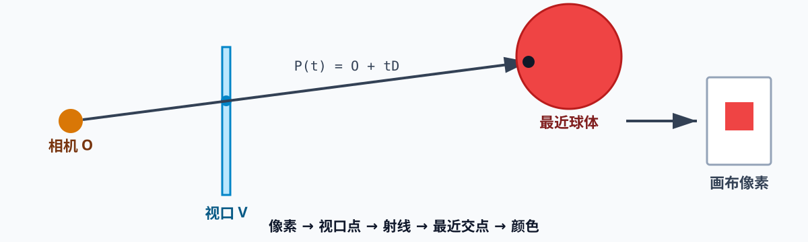
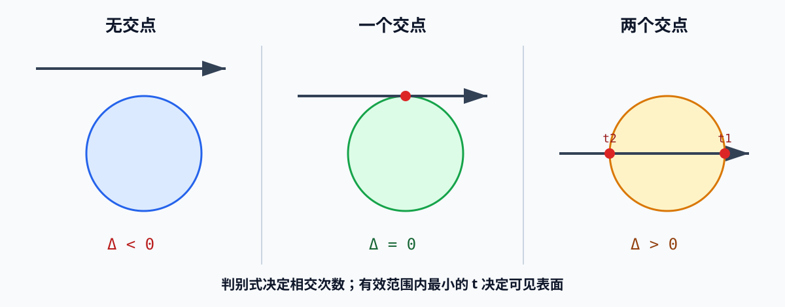

# 第 2 章：基础光线追踪

> 本章目标：从相机向每个像素对应的方向发射一条射线，找到最先碰到的球体，并把球体颜色写入画布。

## 30 秒掌握本章

光线追踪的最小流程只有五步：

> **像素 → 视口点 → 射线 → 最近交点 → 颜色**



一句话理解：

> 对画布上的每个像素，问一句“相机从这里看出去，最先看到谁？”

---

## 1. 为什么从相机反向追踪

现实中的光从光源出发，经过物体后进入眼睛。如果模拟光源发出的全部光子，绝大多数光子永远不会到达相机，计算会被大量浪费。

光线追踪采用反向思路：

```text
相机 O → 视口点 V → 场景
```

只计算最终可能影响画布像素的射线。

记忆：

> **现实追光到眼睛，渲染从眼睛找物体。**

---

## 2. 本章的简化假设

为了先跑通最小算法，本章固定相机与视口：

| 项目 | 设定 |
|---|---|
| 相机位置 | `O = (0, 0, 0)` |
| 相机朝向 | `+Z` |
| 向上方向 | `+Y` |
| 向右方向 | `+X` |
| 视口大小 | `Vw × Vh = 1 × 1` |
| 投影距离 | `d = 1` |
| 视口平面 | `z = 1` |

视口是嵌在三维场景中的二维矩形。相机通过视口观察场景，画布则记录观察结果。

水平视野约为：

```text
FOV = 2 × atan((Vw / 2) / d)
    = 2 × atan(0.5)
    ≈ 53.13°
```

视口越大或距离越近，视野越广；视口越小或距离越远，视野越窄。

---

## 3. 画布像素映射到视口

画布使用像素单位，视口使用场景空间单位。二者中心和方向已经对齐，因此只需按比例缩放：

```text
Vx = x × Vw / Cw
Vy = y × Vh / Ch
Vz = d
```

写成函数：

```cpp
Vector3 canvasToViewport(int x, int y)
{
    return {
        x * viewportWidth / canvasWidth,
        y * viewportHeight / canvasHeight,
        projectionDistance
    };
}
```

记忆：

> **同中心、同方向，只缩放；二维视口嵌在三维中，所以补上 `z=d`。**

---

## 4. 射线方程

从原点 `O` 沿方向 `D` 前进 `t`，射线上的任意点为：

```text
P(t) = O + tD
```

本章中：

```text
O = 相机位置
D = 视口点 V - O
```

由于相机固定在原点，所以当前可以写成 `D = V`，但代码仍保留 `O` 参数，方便后续支持其他射线。

### 参数 t 的含义

| `t` 范围 | 位置 |
|---|---|
| `t < 0` | 相机后方 |
| `0 < t < 1` | 相机与视口之间 |
| `t = 1` | 视口平面 |
| `t > 1` | 视口前方的可见场景 |

本章调用：

```cpp
TraceRay(O, D, 1, infinity);
```

`tMin = 1` 相当于近裁剪面：忽略相机后方以及相机和视口之间的物体。

---

## 5. 球体方程

球体由球心 `C` 和半径 `r` 定义。球面上的点 `P` 到球心的距离恒为 `r`：

```text
|P - C| = r
```

平方后可以避免平方根：

```text
(P - C) · (P - C) = r²
```

点积形式最适合代入射线方程。

---

## 6. 射线与球体求交

交点既在射线上，也在球面上。将 `P(t) = O + tD` 代入球体方程：

```text
(O + tD - C) · (O + tD - C) = r²
```

令：

```text
CO = O - C
```

展开后得到关于 `t` 的一元二次方程：

```text
at² + bt + c = 0

a = D · D
b = 2(CO · D)
c = CO · CO - r²
```

判别式：

```text
Δ = b² - 4ac
```



| 判别式 | 几何意义 | 解的数量 |
|---|---|---:|
| `Δ < 0` | 射线错过球体 | 0 |
| `Δ = 0` | 射线与球体相切 | 1 |
| `Δ > 0` | 射线穿过球体 | 2 |

两个解分别是进入和离开球体的位置：

```text
t1 = (-b + √Δ) / 2a
t2 = (-b - √Δ) / 2a
```

求交函数只负责返回 `t1、t2`，是否位于有效范围以及谁最近，由调用者判断。

---

## 7. 为什么必须选择最近交点

一条射线可能穿过多个球体，但相机只能看到最前面的表面。因此需要遍历全部球体，保留有效范围内最小的 `t`：

```text
closestT = infinity
closestSphere = null

for each sphere:
    t1, t2 = IntersectRaySphere(O, D, sphere)
    保留 [tMin, tMax] 内最小的 t
```

如果没有交点，像素使用背景色；否则使用最近球体的颜色。

记忆：

> **有效看范围，遮挡看最小 t。**

---

## 8. 完整算法

```text
for each canvas pixel (x, y):
    D = CanvasToViewport(x, y)
    color = TraceRay(O, D, 1, infinity)
    PutPixel(x, y, color)
```

`TraceRay` 内部：

```text
遍历全部球体
    计算射线与球体的两个交点
    过滤无效 t
    记录最小 t 对应的球体

命中球体 → 返回球体颜色
没有命中 → 返回背景颜色
```

时间复杂度近似为：

```text
画布像素数 × 球体数量
```

即 `O(width × height × sphereCount)`。

---

## 9. 本章测试场景

```text
视口：1 × 1
投影距离：1

红球：C=( 0,-1,3), r=1
蓝球：C=( 2, 0,4), r=1
绿球：C=(-2, 0,4), r=1
```

最终看到的是三个纯色圆形，而不是具有立体感的球：

> **求交只能确定“看到了谁”，光照才能解释“它看起来有多立体”。**

漫反射、高光和阴影将在后续章节加入。

---

## 10. Qt/C++ 测试程序对应关系

测试程序位于：

```text
计算机图形学入门-案例/ch02-basic-raytracing-qml
```

结构如下：

```text
QML / Qt Quick 3D
  ├─ 左侧：相机、视口和球体的三维教学场景
  ├─ 底部：球体选择与 X/Y/Z 坐标控制
  └─ 右侧：光线追踪生成的 QImage
                         ↑
C++ RayTracer
  ├─ canvasToViewport
  ├─ intersectRaySphere
  ├─ traceRay
  └─ render
```

左侧 Qt Quick 3D 场景用于解释空间关系；右侧仍由 C++ 在 CPU 上逐像素执行本章算法。移动任一球体后，C++ 会重新计算整张画布。

---

## 11. 容易出错的地方

### 把方向 D 强制归一化

本章不要求 `D` 是单位向量。只要求交方程中的 `a = D·D` 保留正确即可。归一化也能工作，但会改变 `t` 的数值含义。

### 只判断有没有交点

渲染不仅需要知道“命中了”，还必须找到有效范围内最近的交点，否则后面的球体可能错误覆盖前面的球体。

### 忘记过滤负数 t

二次方程也会求出相机后方的交点，必须通过 `[tMin, tMax]` 过滤。

### 混淆视口和画布

画布是二维像素结果；视口是三维空间中用于确定射线方向的二维平面。

### 误以为纯色圆形是算法失败

当前没有光照模型，球体只显示自身颜色，所以看起来像圆形。这正是第二章预期结果。

---

## 12. 一页复习卡

```text
核心链路：
像素 → 视口点 → 射线 → 最近交点 → 颜色

相机与视口：
O=(0,0,0)，朝向 +Z
视口 1×1，d=1，FOV≈53°

画布到视口：
V=(x·Vw/Cw, y·Vh/Ch, d)

射线：
P(t)=O+tD

球体：
(P-C)·(P-C)=r²

求交：
a=D·D
b=2(O-C)·D
c=(O-C)·(O-C)-r²
Δ=b²-4ac

可见性：
t 必须落在 [1,∞)
多个交点选择最小 t
没有交点返回背景色
```

---

## 13. 自测题

1. 为什么从相机向场景发射射线，而不是从光源追踪全部光子？
2. 画布像素如何转换为三维视口点？
3. `P(t)=O+tD` 中，`O、D、t` 分别表示什么？
4. 判别式小于、等于、大于零时分别表示什么？
5. 为什么 `TraceRay` 必须保存最小的有效 `t`？
6. 为什么本章渲染出的球体没有立体感？

能独立写出 `CanvasToViewport`、`IntersectRaySphere` 和 `TraceRay`，就真正掌握了第二章。

