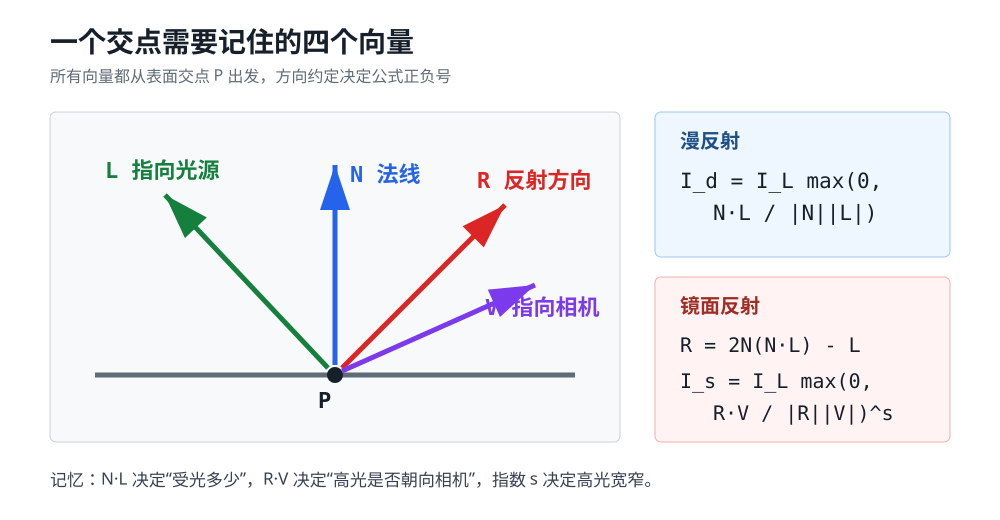

# 第 3 章：光

> 本章目标：在第 2 章“射线命中了谁”的基础上，计算交点接收了多少光，让圆形轮廓呈现出球体的体积和材质感。

## 30 秒掌握本章

核心链路：

> **交点 `P` → 法线 `N` → 光向量 `L` → 漫反射 → 反射向量 `R` → 镜面反射 → 最终颜色**

一句话理解：

> **`N·L` 决定表面有多亮，`R·V` 决定相机能看到多少高光。**



---

## 1. 本章的简化假设

为了突出核心数学，本章暂时假设：

- 所有光都是白光，只用一个实数表示强度。
- 忽略空气吸收，光强不会随传播距离衰减。
- 暂不计算阴影，物体不会挡住照向其他物体的光。
- 间接光照用一个常量环境光近似。

这些假设并不完全真实，但足以建立第一个可用的局部光照模型。

---

## 2. 三种光源

| 光源 | 描述数据 | 交点 `P` 处的光向量 `L` | 直观例子 |
|---|---|---|---|
| 环境光 | 强度 `I` | 无方向 | 房间中的间接散射光 |
| 点光 | 强度 `I`、位置 `Q` | `L = Q - P` | 灯泡 |
| 方向光 | 强度 `I`、固定方向 `L` | 处处相同 | 地面尺度下的太阳 |

注意本书的约定：

> `L` 从表面点指向光源，与真实光线传播方向相反。

环境光只负责提供最低亮度。多个环境光可以直接合并，因此场景通常只需要一个环境光。

---

## 3. 单点光照

对表面上的一个交点，分别计算每盏灯的贡献，再相加：

```text
总光照 I = 环境光 + 所有漫反射 + 所有镜面反射
最终颜色 = 固有颜色 × I
```

RGB 三个通道分别相乘，结果必须限制到 `[0,255]`。

---

## 4. 漫反射：N·L

漫反射用于模拟哑光表面。入射光被粗糙表面向各个方向散射，因此观察位置不会改变漫反射亮度。

漫反射强度：

```text
I_diffuse = I_light × max(0, N·L / (|N||L|))
```

如果 `N` 和 `L` 已归一化，公式就是：

```text
I_diffuse = I_light × max(0, N·L)
```

几何意义：

| `N` 与 `L` 的夹角 | 点积 | 结果 |
|---|---:|---|
| `0°` | `1` | 正对光源，最亮 |
| `0°～90°` | `0～1` | 斜着受光，逐渐变暗 |
| `90°` | `0` | 光线擦过表面 |
| `>90°` | `<0` | 光在背面，贡献按 `0` 处理 |

记忆：

> **越朝向光，单位面积分到的能量越多。**

---

## 5. 球体法线

球心为 `C`，交点为 `P`，球面法线沿球心指向交点：

```text
N = normalize(P - C)
```

这里必须归一化，因为法线不仅要垂直于表面，长度还必须为 `1`。

交点仍来自第 2 章：

```text
P = O + tD
```

---

## 6. 镜面反射：R·V

镜面反射模拟闪亮表面的高光。它取决于观察方向，因此相机移动时高光也会移动。

先计算光向量 `L` 关于法线 `N` 的反射方向：

```text
R = 2N(N·L) - L
```

从交点指向相机的视线向量为：

```text
V = -D
```

镜面反射强度：

```text
I_specular = I_light × max(0, R·V / (|R||V|))^s
```

`s` 是镜面反射指数，也叫光泽度指数：

| `s` | 高光形态 | 材质感觉 |
|---:|---|---|
| 小 | 宽而柔和 | 略有光泽 |
| 大 | 窄而集中 | 非常光滑、闪亮 |
| `-1` | 不计算 | 完全哑光 |

记忆：

> **`R` 越对准相机，高光越强；`s` 越大，高光越尖。**

---

## 7. 完整光照公式

对交点 `P`：

```text
I = I_ambient
  + Σ I_light × max(0, N·L / |N||L|)
  + Σ I_light × max(0, R·V / |R||V|)^s
```

然后：

```text
color = clamp(baseColor × I, 0, 255)
```

环境光没有漫反射和镜面反射项；哑光物体不计算镜面反射项。

---

## 8. 原书场景参数

光源：

```text
环境光：I=0.2
点光：  I=0.6，位置=(2,1,0)
方向光：I=0.2，方向=(1,4,4)
```

球体：

```text
红球：C=( 0,-1,3)，r=1，s=500
蓝球：C=( 2, 0,4)，r=1，s=500
绿球：C=(-2, 0,4)，r=1，s=10
地面：C=(0,-5001,0)，r=5000，黄色，s=1000
```

地面并不是平面，而是一个巨大球体。局部曲率很小，所以看起来像平地。

---

## 9. 六个渐进场景

测试程序在原项目中加入以下模式：

| 模式 | 目的 |
|---|---|
| 纯色基线 | 回看第 2 章，只判断命中对象 |
| 仅环境光 | 观察与角度无关的统一亮度 |
| 仅点光 | 观察 `L = Q-P` 随交点变化 |
| 仅方向光 | 观察场景中处处相同的 `L` |
| 三光源漫反射 | 只呈现体积感，不计算高光 |
| 完整镜面反射 | 比较 `s=500` 和 `s=10` 的高光差异 |

这六个模式共用同一份球体位置，切换模式不会重置你移动过的球体。

---

## 10. 与现有 Qt/C++ 程序的对应关系

```text
QML 场景选择器
    ↓ lightingMode
SceneController::setLightingMode
    ↓ scheduleRender
RayTracer::render
    ├─ 追加黄色地面球
    ├─ 选择当前光源组合
    └─ 对每个像素调用 traceRay
            ↓
        求最近交点 P
        求球面法线 N
        computeLighting(P,N,V,s)
            ├─ 环境光
            ├─ 漫反射 N·L
            └─ 镜面反射 R·V
            ↓
        固有颜色 × 总光照
```

左侧由 Qt Quick 3D 预览空间关系；右侧仍由 C++ 在 CPU 上逐像素执行本章公式。

---

## 11. 容易出错的地方

### 混淆光向量方向

本书使用“交点指向光源”的 `L`。如果改用光传播方向，点积和反射公式的符号必须一起调整。

### 忘记截断负点积

`N·L < 0` 表示灯在表面背后；`R·V < 0` 表示反射方向背离相机。两者都不能作为负光照加入。

### 把镜面反射当成漫反射的替代品

闪亮物体仍有固有颜色和漫反射，高光是在漫反射之上增加的视觉项。

### 忘记限制颜色范围

漫反射和镜面反射相加可能使总强度超过 `1`，RGB 结果必须限制到通道上限。

### 期待本章出现阴影

本章只计算光源对当前交点的局部贡献，没有检测交点到光源之间是否被遮挡。阴影属于第 4 章。

---

## 12. 一页复习卡

```text
三类光：
环境光 = 常量
点光   = L = light.position - P
方向光 = L 固定

交点与法线：
P = O + tD
N = normalize(P - sphere.center)

漫反射：
I_d = I_L × max(0, N·L / |N||L|)

镜面反射：
R = 2N(N·L) - L
V = -D
I_s = I_L × max(0, R·V / |R||V|)^s

最终：
I = I_a + ΣI_d + ΣI_s
color = clamp(baseColor × I)
```

---

## 13. 自测题

1. 点光和方向光的光向量 `L` 有什么区别？
2. 为什么环境光不需要位置和方向？
3. `N·L < 0` 在几何上意味着什么？
4. 球体交点处的法线如何计算？
5. `R·V` 和镜面反射指数 `s` 分别控制什么？
6. 为什么本章已有光照，却仍然没有阴影？

能不看资料写出 `computeLighting(P,N,V,s)`，就掌握了本章核心。
