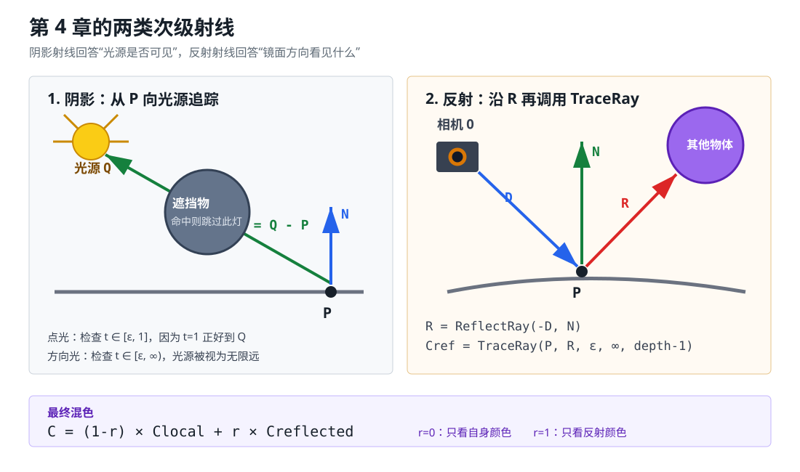

# 第 4 章：阴影和反射

> 本章目标：让光线不只和当前交点发生关系，还能与场景中的其他物体发生关系。

## 30 秒掌握本章

核心链路：

> **主射线找到交点 `P` → 阴影射线判断光源是否可见 → 计算局部颜色 → 反射射线递归追踪 → 按反射率混色**

一句话理解：

> **阴影是“向光源看有没有被挡住”，反射是“沿镜面方向继续看到了什么”。**



---

## 1. 两类新的射线

第 2 章只有从相机发出的主射线，第 4 章增加两类次级射线：

| 射线 | 起点 | 方向 | 解决的问题 |
|---|---|---|---|
| 主射线 | 相机 `O` | 穿过视口 | 当前像素看见谁 |
| 阴影射线 | 交点 `P` | 指向光源 `L` | 这盏灯能否照到 `P` |
| 反射射线 | 交点 `P` | 反射方向 `R` | 镜面方向看见什么 |

三类射线都使用同一件基础工具：

```text
ClosestIntersection(O, D, t_min, t_max)
```

区别只在射线的起点、方向和有效参数范围。

---

## 2. 阴影的本质：光源可见性

第 3 章直接假设光源能够照到交点。第 4 章在计算每盏非环境光之前，增加一次判断：

```text
从 P 向光源发射射线
如果 P 与光源之间命中物体：跳过这盏灯
否则：照常计算漫反射和镜面高光
```

因此阴影没有新的亮度公式，它只是决定某盏灯的贡献是否为 `0`。

环境光没有具体位置和方向，是对间接光的常量近似，所以不发射阴影射线。

---

## 3. 点光与方向光的射线范围

### 点光

点光位置为 `Q`：

```text
L = Q - P
shadowRay(t) = P + tL
```

因为：

```text
shadowRay(1) = P + (Q-P) = Q
```

所以只检查交点到光源之间：

```text
t ∈ [ε, 1]
```

`t > 1` 的物体位于光源后面，不能给 `P` 投下阴影。

### 方向光

方向光被视为无限远，因此沿固定方向检查到无穷远：

```text
t ∈ [ε, +∞)
```

记忆：

> **点光查到 `1`，方向光查到无穷。**

---

## 4. 为什么不能从 t=0 开始

交点 `P` 本来就在物体表面。若次级射线从 `t=0` 开始求交，它可能立刻命中当前表面，使每个点错误地遮挡自己，这叫**自相交**或**阴影痤疮**。

原书使用一个小正数：

```text
ε = 0.001
```

当前 C++ 实现还把次级射线原点沿法线轻微移出表面：

```text
P' = P ± εN
```

这是因为 `float` 存在舍入误差，特别是半径 `5000` 的地面球会放大误差。`ε` 不能为 `0`，也不能大到让相邻物体之间漏光。

---

## 5. 镜面高光不等于镜子反射

第 3 章的 Phong 镜面项：

```text
I_specular ∝ max(0, R·V)^s
```

它只产生一个亮斑，用来表现表面是否光滑，并不会显示其他物体。

第 4 章的递归反射则会真正沿 `R` 继续查询场景：

```text
reflectedColor = TraceRay(P, R, ε, +∞, depth-1)
```

| 概念 | 得到什么 | 是否再次追踪场景 |
|---|---|---|
| 镜面高光 | 光源形成的亮斑 | 否 |
| 镜子反射 | 其他物体及背景的像 | 是 |

---

## 6. 反射方向

主射线方向 `D` 从相机指向交点，因此 `-D` 从交点指回相机。将 `-D` 关于法线 `N` 镜像：

```text
ReflectRay(X, N) = 2N(N·X) - X

R = ReflectRay(-D, N)
```

这和第 3 章计算镜面高光使用的是同一个反射公式，只是输入不同：

- 镜面高光：反射光向量 `L`，再与相机方向 `V` 比较。
- 递归反射：反射视线向量 `-D`，再沿结果 `R` 追踪场景。

---

## 7. 为什么必须限制递归深度

如果两面镜子互相反射，`TraceRay` 会不断调用自身。必须设置退出条件：

```text
没有命中物体                 → 返回背景色
物体反射率 r = 0             → 返回局部颜色
recursionDepth = 0           → 返回局部颜色
否则                         → 再追踪一条反射射线
```

递归深度的含义：

| 深度 | 能看到的内容 |
|---:|---|
| `0` | 只有局部光照，没有物体倒影 |
| `1` | 一次反射 |
| `2` | 反射中的物体还能再反射一次 |
| `3` | 通常已经足够，继续增加差异很小 |

深度限制既保证程序终止，也控制渲染耗时。

---

## 8. 反射率与颜色混合

反射通常不是全有或全无。令反射率 `r ∈ [0,1]`：

```text
finalColor = localColor × (1-r) + reflectedColor × r
```

| `r` | 结果 |
|---:|---|
| `0` | 完全使用物体自身的局部颜色 |
| `0.5` | 局部颜色和反射颜色各占一半 |
| `1` | 理想镜面，只显示反射颜色 |

本章场景参数：

```text
红球：r=0.2
蓝球：r=0.3
绿球：r=0.4
地面：r=0.5
```

注意：反射率 `r` 和第 3 章的镜面指数 `s` 不是同一个量。

```text
s：控制高光宽窄
r：控制倒影占最终颜色的比例
```

---

## 9. 完整算法流程

```text
TraceRay(O, D, tMin, tMax, depth)
    ↓
ClosestIntersection(O, D, tMin, tMax)
    ├─ 未命中：返回背景色
    └─ 命中球体：得到 P、N
            ↓
        ComputeLighting(P, N, -D)
            ├─ 环境光：直接加入
            └─ 点光/方向光
                  ├─ 发射阴影射线
                  ├─ 被遮挡：跳过此灯
                  └─ 未遮挡：计算漫反射和镜面高光
            ↓
        localColor = baseColor × intensity
            ↓
        depth=0 或 r=0？
            ├─ 是：返回 localColor
            └─ 否：R = ReflectRay(-D,N)
                    reflectedColor = TraceRay(P,R,ε,∞,depth-1)
                    返回 (1-r)localColor + r reflectedColor
```

---

## 10. 与现有 Qt/C++ 程序的对应关系

| 概念 | 代码位置 |
|---|---|
| 材质反射率 | `Sphere::reflectivity` |
| 最近交点复用 | `RayTracer::closestIntersection` |
| 阴影检测 | `RayTracer::computeLighting` |
| 反射方向 | `RayTracer::reflectRay` |
| 次级射线偏移 | `RayTracer::offsetRayOrigin` |
| 递归与颜色混合 | `RayTracer::traceRay` |

程序在原来的六种模式后新增三种模式：

| 模式 | 效果 |
|---:|---|
| `6` | 完整局部光照 + 硬阴影 |
| `7` | 阴影 + 一次反射 |
| `8` | 阴影 + 三层递归反射 |

左侧 Qt Quick 3D 用于预览遮挡和材质关系；右侧画布仍由 C++ 在 CPU 上逐像素执行本章算法。

---

## 11. 容易出错的地方

### 点光阴影射线追踪到无穷远

这样会让光源后面的物体错误地投下阴影。点光的 `tMax` 必须为 `1`。

### 环境光也进行阴影检测

环境光没有位置和方向，不能构造阴影射线。

### 次级射线从 t=0 开始

射线会立即命中自身表面，产生黑点、条纹或整片错误阴影。

### 递归深度没有递减

相互反射的物体会导致无限递归。每次递归必须传入 `depth-1`。

### 直接用反射颜色覆盖局部颜色

除非 `r=1`，否则必须按照反射率混合两种颜色。

### 混淆 s 和 r

`s` 决定高光形状，`r` 决定物体倒影的占比，两者可以同时存在。

---

## 12. 一页复习卡

```text
阴影：
点光       L=Q-P，t∈[ε,1]
方向光     L固定，t∈[ε,∞)
命中遮挡物 → 跳过当前灯

反射：
R = ReflectRay(-D,N)
Cref = TraceRay(P,R,ε,∞,depth-1)

混色：
C = (1-r)Clocal + rCref

终止：
未命中 / r=0 / depth=0
```

记忆：

> **先问灯能不能看见，再问镜子里能看见谁。**

---

## 13. 自测题

1. 为什么点光阴影射线的 `tMax` 是 `1`？
2. 为什么方向光的 `tMax` 是正无穷？
3. `ε` 解决了什么问题？
4. Phong 镜面高光和递归反射有什么区别？
5. 为什么 `TraceRay` 可以直接用于计算反射颜色？
6. 反射率 `r=0.25` 时，局部颜色和反射颜色各占多少？

能独立写出“阴影检测 + 递归反射 + 颜色混合”，就掌握了本章核心。
